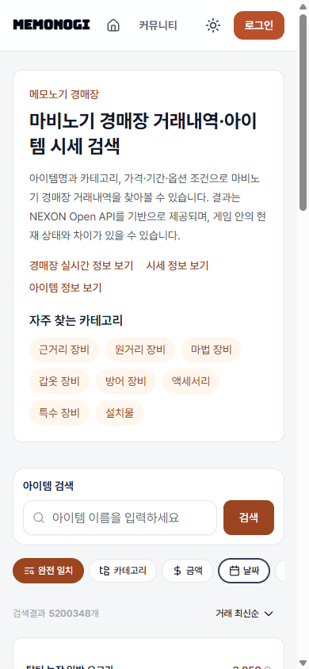
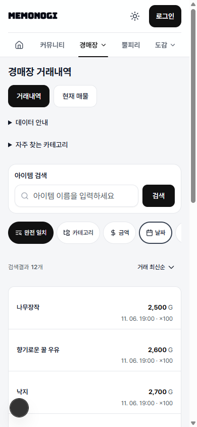
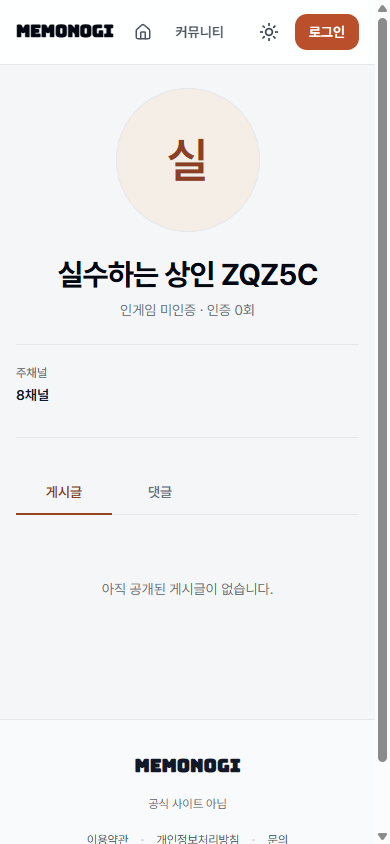
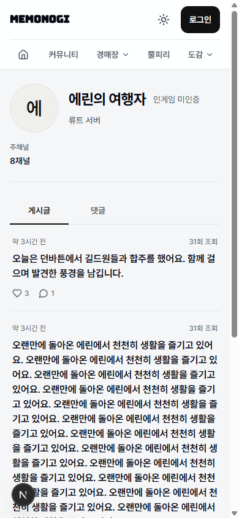
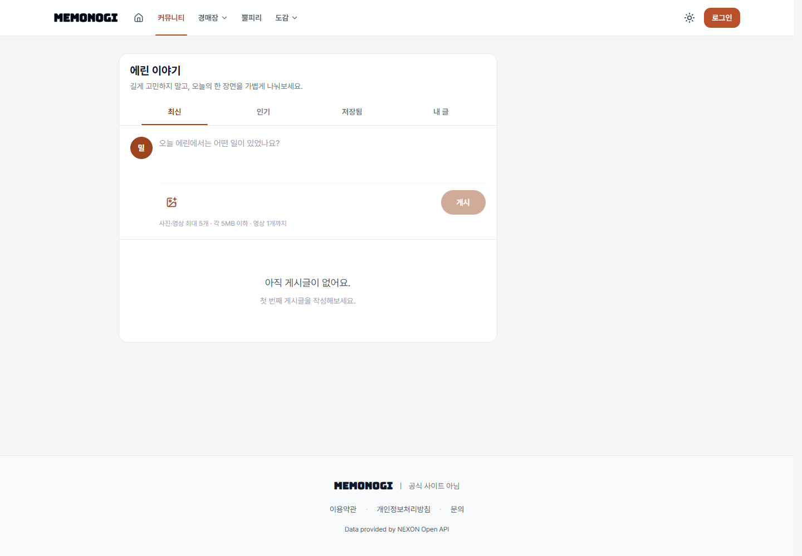
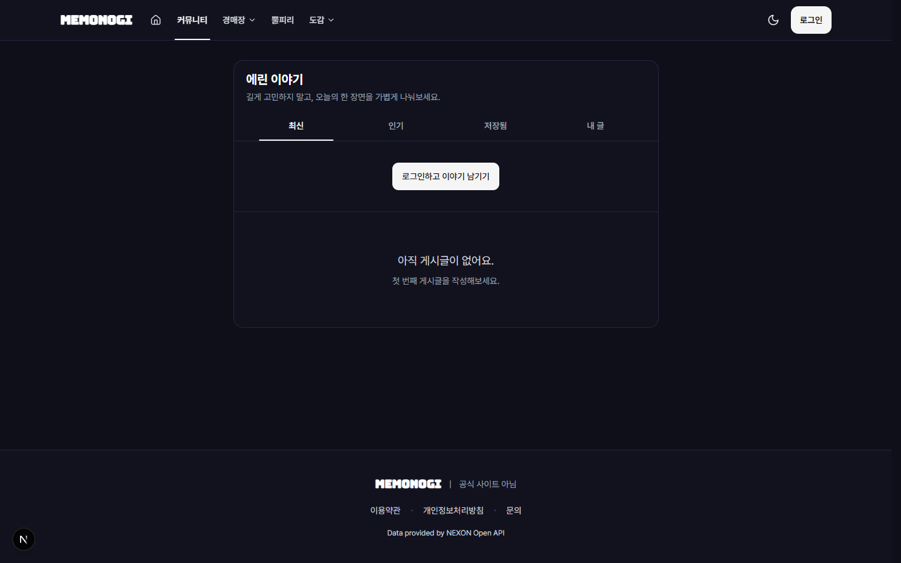

# 화면 개선 revision 1 검증 기록

대상: `devnogi-react`, `feat/ui-design-consistency`, version `1.0.15`.
기준 main: `5292ec64ccf9df01a0c36dfd80d0d0aa16f1d242`.

## 구현 범위

- 기본 액션·선택 배경을 전역 흑백 규칙으로 통일하고 DESIGN.md/README를 정리했다.
- 모바일 헤더 64px + 메뉴 48px, 경매장 제목/탭/검색 순서와 접힘 안내, 테마별 필터 모달을 적용했다.
- 뿔피리 메타데이터·본문 밀도를 조정하고 정확한 작성자 접두어만 한 번 제거한다.
- 커뮤니티 인기글 상태에 따른 열 구성, 로그인 후 작성 흐름, 방문 프로필 밀도를 개선했다.
- 시세 조회 예시 최대 3개, 도감 제목과 분류 용어를 적용했다.
- 검사 중 발견한 경매 URL/상태 동기화 경쟁과 직접 URL 진입 후 옵션 보존 문제를 회귀 테스트와 함께 보완했다.
- 홈 본문 폭·글꼴 크기·카드 배치·히어로 구성 및 마이페이지 편집·인증 구조는 유지했다. 새 패키지, API, 응답 타입, DB 변경은 없다.

## Chromium 화면 및 동작

로컬 Next.js와 합성 fixture gateway를 사용했다. 운영에 테스트 게시물을 만들거나 계정 정보를 변경하지 않았다. 이전 캡처는 운영 감사 당시 화면, 이후 캡처는 합성 콘텐츠이므로 데이터 내용 자체는 비교 대상이 아니다.

| 확인 대상                                                  | 결과                                                                                                                                                    |
| ---------------------------------------------------------- | ------------------------------------------------------------------------------------------------------------------------------------------------------- |
| 홈·거래내역·현재 매물·뿔피리·커뮤니티·프로필 2종·시세·도감 | 390×844, 768×900, 1440×900 / 라이트·다크 54개 조합에서 문서 가로 넘침 없음                                                                              |
| 모바일 메뉴                                                | 5개 메뉴 노출, 메뉴 높이 48px, clientWidth/scrollWidth 모두 343px. Enter/Space 열기, Escape 닫기·포커스 복귀, 바깥 클릭 닫기 확인                       |
| 경매장                                                     | 390px에서 검색·필터와 첫 결과 노출. 거래내역 첫 제목 y=598px. 탭 이동은 아이템명·상위/하위 분류만 승계, 뒤로 이동 시 기존 URL 복원                      |
| 필터 모달                                                  | 라이트/다크 본문·입력·하단 액션 확인. 적용 버튼 높이 48px. 세공 추천을 포인터와 Enter로 선택·적용, URL 유지와 새로고침 후 복원 확인                     |
| 커뮤니티                                                   | 인기글 로딩 시 보조 열, 성공 시 680px+280px, 빈 결과/실패 확정 시 중앙 680px 단일 열. 게스트 로그인 창 및 인증 fixture 작성 창, Escape/포커스 복귀 확인 |
| 실제 콘텐츠 형태                                           | 로컬 글·사진·댓글·긴 본문·긴 닉네임, 최소/전체 프로필 및 빈 활동 상태 확인                                                                              |
| 뿔피리·도감                                                | 서버 필터 적용과 본문 보존, 도감 행 펼침 유지 확인                                                                                                      |
| 시세 예시                                                  | 아이템명+분류 동시 반영. `weekly`, `2026-10-01`~`2026-11-01` 유지 확인                                                                                  |
| 홈 회귀                                                    | 본문/히어로 컴포넌트 diff는 액션·포커스 색상에 한정. 화면 배치와 크기 유지                                                                              |

기본 액션 대비는 라이트 약 18.9:1, 다크 약 17.3:1이다. 보조 일반 텍스트는 흰 카드의 gray-500(4.83:1), 회색 본문의 gray-600, 다크의 gray-400을 사용하도록 보완했다. 의미색·비활성 상태를 일괄 치환하지 않았다. 이 검증은 변경 영역의 대비·키보드·터치 동작 점검이며 사이트 전체 WCAG 인증은 아니다.

## 변경 전후 캡처

| 화면               | 이전                                                               | 이후                                                              |
| ------------------ | ------------------------------------------------------------------ | ----------------------------------------------------------------- |
| 모바일 경매장      |     |     |
| 모바일 방문 프로필 |     |     |
| 비어 있는 커뮤니티 |  |  |

추가 확인: [다크 필터](ui-design-consistency/after-filter-dark.png), [뿔피리](ui-design-consistency/after-horn-mobile.png), [콘텐츠가 있는 커뮤니티](ui-design-consistency/after-community-populated.png), [시세 예시](ui-design-consistency/after-statistics.png).

## 자동 검사와 검토

- Node.js 20.20.2 사용. `npm ci` 완료, 패키지 추가 없음.
- `npm run verify`: 포맷·포맷 검사 테스트·ESLint·TypeScript·Knip·Jest 80 suites/332 tests·production build 모두 통과.
- `node --test scripts/workflow-contract.test.mjs scripts/test-production-workflow.mjs`: 9/9 통과.
- `node scripts/secret-scan.mjs`: 발견 0건.
- 독립 검토자가 실제 diff와 회귀 테스트를 확인하고 최종 승인했다. 다크 foreground 누락, 선택 배경 우회, 모달 내부 세공 포털, URL 필터 보존, 지연된 옵션 메타데이터 지적을 반영했으며 미해결 지적은 없다.
- 기존 이미지 ESLint 경고와 Knip 설정 힌트는 오류와 구분했다. 실제 OAuth 공급자 로그인과 운영 데이터 쓰기는 수행하지 않았다.
- PR의 필수 workflow-contract, validate, version-policy, verify, container 검사를 확인한다. 병합·운영 배포는 별도 사람 승인 대상이다.
